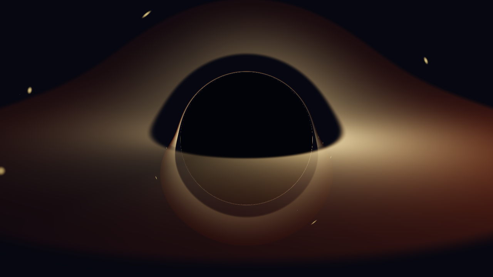

# Grafika 3D – czarna dziura

Projekt zaliczeniowy z Grafiki 3D. OpenGL, Linux.  
Na ekranie czarna dziura z dyskiem i soczewkowaniem, kamera mysza, parametry na klawiszach, bonus czastki. Shader GLSL (port ze Shadertoy).

Szczegoly: `plan-projektu.md`, docs w `docs/`.



## Stack

C++17, OpenGL 3.3, GLSL, GLFW, GLAD (`external/glad`), glm, CMake.  
GLFW/glm sciaga sie przez FetchContent jak nie ma w systemie.

## Zaleznosci (Ubuntu/Debian)

```bash
sudo apt install build-essential cmake libglfw3-dev libglm-dev libxinerama-dev
```

Bez paczek GLFW/glm CMake pobierze je przy `cmake ..` (trzeba sieci).  
Jak brakuje Xineramy, jest lokalny `external/x11_extra`. Potrzebny tez sterownik OpenGL.

## Budowanie

```bash
mkdir -p build && cd build
cmake ..
cmake --build .
./blackhole
```

Shadery sa podpinane przez `SHADER_DIR` przy kompilacji, wiec odpalasz z `build/`.

## Sterowanie

- LMB – orbit kamery
- scroll – zoom
- `+/-` – masa / sila soczewki
- `[` `]` – predkosc czasu
- `1/2/3` – jakosc (kroki w shaderze)
- `D` – Doppler
- `P` – czastki
- `R` – reset
- `Esc` – wyjscie

Wiecej screenow: `docs/screenshots/` (orbit, zoom).

## Pliki

`src/` – main, shader, camera, particles  
`shaders/` – fullscreen.vert, blackhole.frag  
`docs/` – uzytkownik, techniczna, zrodla  

Repo: `git@github.com:EmiliaM81/Grafik3D.git`
